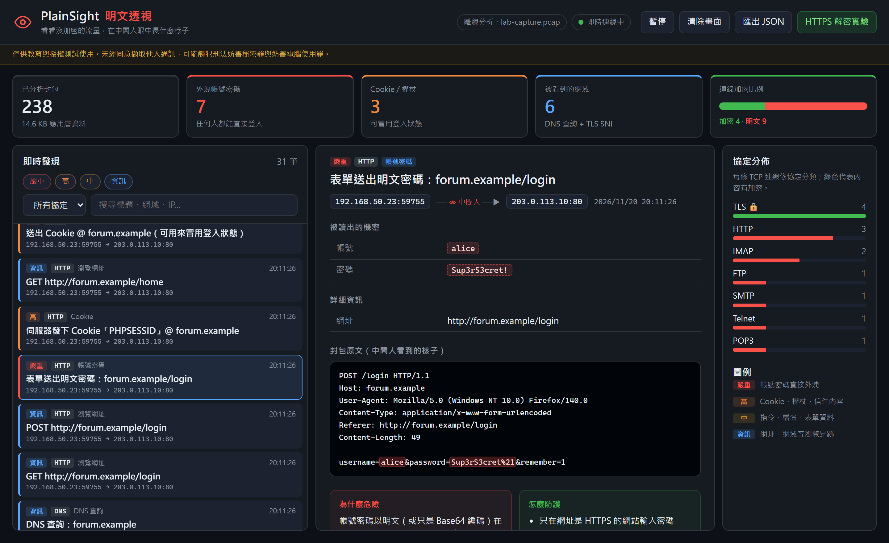

# PlainSight 明文透視

> 看看沒加密的流量，在中間人眼中長什麼樣子。
> *An educational dashboard that shows what an eavesdropper sees in unencrypted traffic.* ([English](#english))

[](https://github.com/tntrock/plainsight/actions/workflows/ci.yml)




「公共 Wi-Fi 很危險」「要用 HTTPS」——大家都聽過，但很少人真的**看過**危險長什麼樣子。
PlainSight 分析經過你電腦的網路流量，把攻擊者能讀到的東西即時顯示在儀表板上：

| 你會看到 | 例子 |
|---|---|
| 🔴 明文帳號密碼 | HTTP 表單登入、HTTP Basic 認證、FTP、Telnet、POP3、IMAP、SMTP AUTH |
| 🟠 可冒用身分的資料 | Session Cookie、Bearer Token、網址中的 token、明文電子郵件內容 |
| 🟡 操作紀錄 | Telnet 每個按鍵與指令、FTP 上傳下載的檔名、表單資料 |
| 🔵 瀏覽足跡 | 造訪的 HTTP 網址、DNS 查詢、**HTTPS 連線的網域（TLS SNI）** |
| 🟣 HTTPS 被解密 | 搭配 mitmproxy，示範裝置信任惡意憑證後，HTTPS 也會被看光 |

每一筆發現都附上**封包原文**（標出機密位置）、**為什麼危險**與**怎麼防護**，適合資安課程、社團講座或自學。

## ⚠️ 使用前必讀

- **只能在你擁有、或已取得書面授權的網路與裝置上使用。**
  未經同意擷取他人通訊，可能觸犯中華民國刑法第 315-1 條（妨害秘密）、第 358–363 條（妨害電腦使用），以及個人資料保護法；其他國家也有類似法律。
- PlainSight **只被動觀察**經過本機網卡的流量，刻意**不提供** ARP 欺騙、DNS 欺騙等主動攻擊功能。
- 擷取到的帳號密碼會**完整顯示**，請妥善保管匯出的資料；即時擷取前會要求確認授權。
- 課堂展示建議使用測試帳號，或改分析事先錄好的 pcap 檔。

## 下載 Windows 版（免安裝）

到 [Releases](https://github.com/tntrock/plainsight/releases/latest) 下載 **`PlainSight.exe`**，雙擊即可：

- 會出現選單：分析 pcap、即時擷取、MITM 代理、列出網卡、安裝 Npcap。
- 把 `.pcap` / `.pcapng` 檔**拖到 PlainSight.exe 上**就會直接分析。
- 也能在命令列使用，參數與下方 `plainsight` 指令完全相同，例如 `PlainSight.exe live -i 1`。

> 首次執行若出現 SmartScreen「Windows 已保護您的電腦」，請按「其他資訊 → 仍要執行」——程式沒有付費的程式碼簽章。
> 封包分析工具偶爾會被防毒軟體誤判；不放心的話可以用下方方式從原始碼執行，或自己建置 exe。

### 即時擷取：不用先裝任何東西

| 擷取引擎 | 需要 | 能看到 |
|---|---|---|
| **Windows 內建**（未安裝 Npcap 時自動使用） | 系統管理員權限（程式會自動跳出 UAC 詢問） | IPv4 流量 |
| **Npcap**（已安裝時自動使用） | 不需管理員（Npcap 預設） | IPv4 + IPv6、完整乙太網路封包、BPF 過濾 |

想要完整功能，可在選單選「安裝 Npcap」或執行 `PlainSight.exe install-npcap`：程式會從官方網站 npcap.com
下載最新版、**驗證數位簽章**後開啟安裝程式。

> 為什麼不直接把 Npcap 包進 exe？Npcap 免費版的授權**不允許重新散布**（需購買 Npcap OEM 授權），
> 所以改由使用者從官方來源安裝。

## 從原始碼安裝

需要 Python 3.10 以上。

```bash
git clone https://github.com/tntrock/plainsight.git
cd plainsight
python -m venv .venv
# Windows: .venv\Scripts\activate    macOS/Linux: source .venv/bin/activate
pip install -e .
```

即時擷取：Windows 可直接使用（見上方說明）；Linux / macOS 以 `sudo` 執行。

## 使用方式

```bash
plainsight pcap capture.pcapng  # 分析 Wireshark / tcpdump 錄下的檔案（開啟儀表板）
plainsight pcap capture.pcapng --report   # 不開儀表板，直接在終端機列出帳密等結果
plainsight ifaces               # 列出網卡（附編號、類型與 IP）
plainsight live -i 2            # 即時擷取第 2 張網卡（需授權與管理員權限）
plainsight live -i 1,2          # 同時擷取多張網卡，例如熱點 + 乙太網路
plainsight mitm                 # 搭配 mitmproxy 示範 HTTPS 被解密
plainsight install-npcap        # 從官網下載並安裝 Npcap（Windows，選用）
```

啟動後瀏覽器會自動開啟 `http://127.0.0.1:8765/`。常用選項：

| 選項 | 說明 |
|---|---|
| `--port 9000` | 換儀表板埠號 |
| `--no-browser` | 不自動開瀏覽器 |
| `pcap --report --info` | 終端機報告中也列出網址、DNS、SNI |
| `live --backend raw` | 強制使用 Windows 內建擷取（`auto` / `npcap` / `raw`） |
| `live -i 名稱或編號` | 選擇網卡，可用逗號分隔或重複 `-i` 指定多張 |
| `ifaces --all` | 也列出沒有 IP 的網卡與系統篩選驅動程式 |
| `live --bpf "tcp port 80"` | 自訂擷取過濾條件 |

## 實驗情境

詳細步驟見 **[docs/lab-guide.md](docs/lab-guide.md)**，摘要如下：

1. **自己當中繼節點**：用電腦開行動熱點，讓**自己的**實驗手機連上，再對熱點網卡執行 `plainsight live`。所有流量都會經過你的電腦，就像咖啡廳的 Wi-Fi 業者或惡意熱點一樣。
2. **HTTPS 解密**：用 mitmproxy 當代理，在實驗裝置安裝其根憑證，觀察 HTTPS 內容被完整解密——藉此理解「不要安裝來路不明的憑證、不要忽略憑證警告」。
3. **離線分析**：分析 Wireshark 範例檔或 CTF 題目的 pcap。

> 為什麼在家用網路上 `live` 只看得到自己的流量？因為現代交換器只把封包送給目的地，Wi-Fi 也各自加密。這本身就是很好的教材：竊聽者必須先成為「中間人」，而這正是惡意熱點、被入侵的路由器最危險的地方。

## 架構

```
封包來源 (pcap / live)             mitmproxy + mitm_addon.py
        │ Scapy / Npcap / Windows 原始通訊端 │ HTTP POST（本機、需 token）
        ▼                                 ▼
  Engine：TCP 重組 → 依內容/埠號分派 ──► 協定分析器 (HTTP, TLS, FTP, SMTP, IMAP, POP3, Telnet, DNS)
                                          │ Finding
                                          ▼
                     Hub：去重 ──────────► Web 儀表板（Server-Sent Events 即時推送）
```

- 純 Python 標準函式庫的 Web 伺服器，唯一相依套件是 Scapy。
- 儀表板只監聽 `127.0.0.1`，有 CSP、DNS rebinding 防護；封包內容一律以純文字呈現，不會被當成 HTML 執行。
- 新增協定：在 `plainsight/analyzers/` 繼承 `StreamAnalyzer` 或 `LineAnalyzer`，再登記到 `PORT_ANALYZERS`。

## 開發

```bash
pip install -e ".[dev]"
pytest
```

自己建置 exe（Windows）：

```powershell
powershell -ExecutionPolicy Bypass -File build.ps1   # 產生 dist\PlainSight.exe
```

發佈新版：更新 `plainsight/__init__.py` 與 `pyproject.toml` 的版本號，推送 `v*` 標籤（例如 `git tag v0.2.1 && git push origin v0.2.1`），GitHub Actions 會自動建置 exe 並建立 Release。

歡迎 PR！特別歡迎：更多協定（SNMP、LDAP、Redis、MQTT…）、英文介面、更多教學情境。
提交與「主動攻擊」相關的功能（ARP/DNS 欺騙、SSL strip 等）將不會被接受。

## 授權

[MIT](LICENSE)。本軟體僅供教育與授權的安全測試使用，使用者需自行承擔使用責任。

---

## English

**PlainSight** is an educational tool that makes the risks of unencrypted traffic visible.
It passively analyzes traffic passing through your machine (live, or from a pcap file) and shows on a web dashboard what an eavesdropper can read: plaintext passwords
(HTTP forms, Basic auth, FTP, Telnet, POP3, IMAP, SMTP), session cookies and tokens, emails,
DNS queries and TLS SNI. A mitmproxy addon demonstrates how HTTPS is fully decrypted once a device
trusts a malicious root certificate. Every finding comes with the raw packet text and an explanation
of why it is dangerous and how to defend against it.

```bash
pip install -e .
plainsight pcap file.pcapng            # dashboard
plainsight pcap file.pcapng --report   # print findings to the terminal
plainsight live -i 1                   # only on networks you own or are authorized to test
```

Use it only on networks and devices you own or have written permission to test. The tool deliberately
contains no active attack features (no ARP/DNS spoofing). On Windows, live capture works without Npcap
(built-in raw sockets, IPv4, administrator rights); `plainsight install-npcap` installs Npcap from its
official site for full capture.
The UI is currently in Traditional Chinese; translations are welcome.
